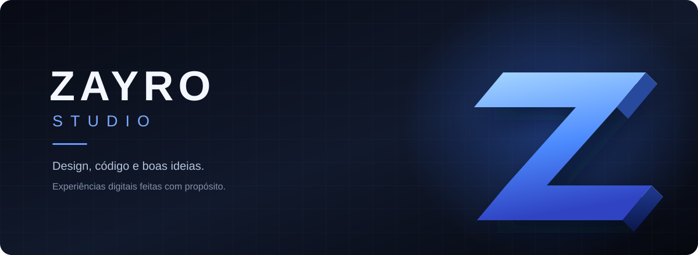

<div align="center">



<br>

# Zayro Studio

**Ideias ganham forma. Marcas ganham presença.**

Site institucional do Zayro Studio — um estúdio digital independente que cria sites, sistemas e experiências digitais sob medida.


</div>

---

## ✦ Sobre o projeto

Este repositório reúne o site institucional da **Zayro Studio**. A experiência combina uma identidade visual escura, tipografia marcante, interações suaves e uma apresentação direta do estúdio, dos serviços e dos trabalhos realizados.

O foco é comunicar com clareza o que fazemos — sem excesso de efeitos ou promessas genéricas.

### Destaques

- **Design responsivo:** layout pensado para desktop e dispositivos móveis.
- **Interações cuidadosas:** animações e microinterações em JavaScript e CSS.
- **Acessibilidade:** link para pular ao conteúdo, estados de foco e suporte a movimento reduzido.
- **Projetos reais:** links diretos para os sites publicados dos clientes.
- **Estrutura enxuta:** HTML, CSS e JavaScript, sem etapa de build.
- **Organização:** recursos separados em `assets/` para facilitar manutenção.

> O banner acima é uma arte vetorial com **efeito visual 3D**, criada para a documentação. Ele não significa que o site utiliza uma engine 3D ou WebGL.

## ◈ Prévia

Abra o arquivo `index.html` no navegador para visualizar a versão local. Para testar em um servidor HTTP local, execute na raiz do projeto:

```bash
python -m http.server 8000
```

Depois acesse **http://localhost:8000**.

Não é necessário instalar dependências ou rodar `npm install`. A conexão com a internet é usada para carregar fontes do Google Fonts e abrir links externos.

## 📁 Estrutura

```text
zayro-studio/
├── index.html
├── README.md
├── robots.txt
└── assets/
    ├── branding/
    │   └── readme-banner.svg
    ├── css/
    │   └── style.css
    ├── js/
    │   └── main.js
    └── images/
        ├── equipe-carlos-eduardo.webp
        ├── equipe-joao-vitor.webp
        ├── projeto-rodrigo-silva.webp
        ├── projeto-tempero-leve.webp
        ├── zayro-favicon.jpg
        └── zayro-imagem-compartilhamento.webp
```

## ⚙️ Tecnologias

| Tecnologia | Uso |
| --- | --- |
| **HTML5** | Conteúdo, semântica e metadados |
| **CSS3** | Layout responsivo, identidade visual e transições |
| **JavaScript (vanilla)** | Menu, interações e efeitos de navegação |
| **WebP / SVG** | Imagens otimizadas e arte vetorial |
| **Google Fonts** | Tipografia Inter e Manrope |

## 🌐 Projetos apresentados

| Projeto | Site oficial |
| --- | --- |
| **Tempero Leve** | [temperoleve.com.br](https://www.temperoleve.com.br/) |
| **Rodrigo Silva — Visagismo** | [rodrigosilvavisagismo.com.br](https://rodrigosilvavisagismo.com.br/) |

Os cards do portfólio levam diretamente aos sites oficiais. Não existem páginas HTML individuais de projetos neste pacote.

## 🛠️ Como personalizar

1. **Textos e seções:** edite `index.html`.
2. **Cores, fontes e espaçamentos:** edite `assets/css/style.css`.
3. **Animações e navegação:** edite `assets/js/main.js`.
4. **Imagens:** substitua os arquivos em `assets/images/`, mantendo os caminhos usados no HTML ou atualizando-os.
5. **Arte do README:** personalize `assets/branding/readme-banner.svg`.

Ao editar, preserve as descrições alternativas de imagens e a opção de movimento reduzido.

## 🚀 Antes de publicar

- [ ] Confirmar domínio oficial e hospedagem.
- [ ] Configurar URL canônica, `og:url` e URL absoluta da imagem de compartilhamento.
- [ ] Criar `sitemap.xml` usando o domínio definitivo.
- [ ] Verificar WhatsApp, e-mail, LinkedIn e links externos.
- [ ] Testar em dispositivos móveis e navegadores diferentes.
- [ ] Conferir acessibilidade e performance com ferramentas de auditoria.
- [ ] Conectar Google Search Console após a publicação.

**Nota:** o projeto está em fase de pré-lançamento. Não há domínio oficial definido nesta documentação, e nenhuma pontuação de performance é declarada sem medição.

## 🤝 Contato

Para conhecer o estúdio ou conversar sobre um projeto, utilize os canais de contato disponibilizados no site.

---

<div align="center">

**ZAYRO STUDIO**  
*Design, tecnologia e ideias que saem do papel.*

<sub>Feito com atenção aos detalhes.</sub>

</div>
